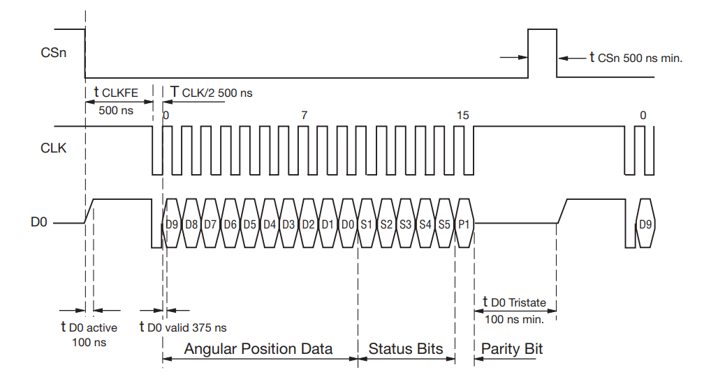

# EMS22A
This is the front encoder we are using for steering (absolute encoder).

https://www.bourns.com/pdfs/EMS22A.pdf

## Data Protocol

1. Idle: CS, CLK HIGH (No Data Transfer)
2. Initiate Read: CS LOW
3. CLK Pulses: One bit is transmitted a time at each rising edge on DO
4. Microcontroller samples DO and shifts each bit into register
5. Clean: Return to CS HIGH
6. Repeat

## Status Bits

| Raw Bit | Name | Meaning | Expected Value |
|:---:|---|---|:---:|
| 5 | OCF | Offset compensation finished | 1 |
| 4 | COF | CORDIC overflow | 0 |
| 3 | LIN | Linearity alarm | 0 |
| 2 | Mag INC | Magnetic field increasing | Diagnostic |
| 1 | Mag DEC | Magnetic field decreasing | Diagnostic |
| 0 | P1 | Even parity bit | Valid parity |

**Basic validation requirements:**
- OCF = 1 (compensation complete)
- COF = 0 (no overflow)
- LIN = 0 (no linearity alarm)
- Even parity across all 16 bits must pass

Mag INC and Mag DEC are retained for diagnostics.
